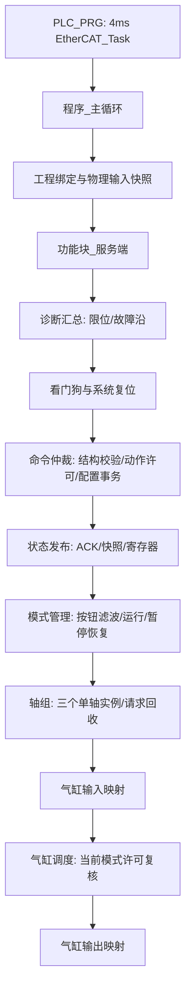

# PLC 架构与维护规范

本轮将按文件种类堆放的源码改为按职责组织。IEC对象名与对外Axis/Cy业务接口保持稳定，协议仍为1.3；目录不是运行顺序，唯一周期入口决定顺序。

## 目录

| 目录 | 职责 |
|---|---|
| plc/src/entry | 唯一主循环，展示扫描顺序，不实现业务状态机 |
| plc/src/application | 模式、暂停恢复、系统复位、动作许可、运行时 |
| plc/src/communication | Modbus命令仲裁、诊断摘要、发布、看门狗及生成地址表 |
| plc/src/configuration | 保持配置事务、点位归属、参数额定与拒绝码辅助 |
| plc/src/motion | 轴组、单轴MC拥有者、请求完成回收和语义API |
| plc/src/cylinder | 气缸驱动、调度、请求与语义API及类型 |
| plc/src/hardware | 工程绑定、物理映像、输入/输出映射、现场常量 |
| plc/tests | 隔离IEC扫描自测，不属于生产任务 |
| plc/tools | XS离线重建与验证工具 |

## 扫描与状态归属

- 服务端拥有网络SEQ/ACK及命令抢占；内部请求不能污染网络ACK。
- 诊断FB拥有故障沿历史及饱和报警计数；只写派生限位反馈，不下发运动。
- 发布FB拥有心跳、发布时间、快照与绑定纪元；只有它写Published。Runtime/Store即时引用，不复制整份运行时缓存。
- 复位FB拥有阶段、序列和超时。Operation=0每扫描在原位置推进一次；1受理、2取消不重复推进定时器。
- 模式FB拥有运行与暂停恢复握手。轴组集中物理轴引用和参数兜底。
- 单轴FB保留所有MC实例及制动状态，避免将互相耦合的MC实例分散到多个调用者。每轴每扫描调用一次。
- 气缸调度拥有驱动实例阵列；硬件映射负责I/O，业务函数不直接写物理输出。

## 合并与精简

Axis_Home/MoveToPoint/Stop保持原签名，但请求入槽统一到Axis_提交。Cy动点/原点/取消统一到Cy提交，再进入唯一气缸_提交。语义外观保留，方便工艺代码阅读。

配置事务保持“候选校验后统一提交”，只提取重复的点位归属解码，删除已被函数_额定值覆盖的范围校验。删除无引用旧类型结构体_气缸工程，并在XS工程中清除旧对象。

XP源仓库的正式工程还会残留旧厂商工程的对象和目录。重建工具现在以源码集合为唯一依据：除 `PLC_PRG`（任务入口包装）和 `PersistentVars`（保持变量列表）外，工程中任何不在 `plc/src` 内的文本对象都会被删除，并清理空的 `01_类型…05_程序`、`XJV1` 历史目录。已验证删除 `Axis_Busy`、`Axis_Done`、`Axis_Error` 三个旧函数及六个空目录；验证脚本会在残留任何多余对象或目录时失败。

服务端614行降至323行；主循环168行降至35行；配置288行降至274行。新增模块接口使总代码略有增加，目标是缩小单模块复杂度和重复状态，而不是靠删除保护逻辑追求行数。本轮64个生产源码文件、65个IEC对象已离线重建并逐对象核对，工程内七个SRC_*域文件夹及唯一4ms任务调用均通过验证。本轮XS生成代码1,406,676字节、全局数据302,253字节，较修复基线分别增加4,122字节（约0.29%）及1,454字节（约0.48%）。本轮未声称缩小二进制；瘦身体现在入口、服务端和重复提交逻辑，模块化接口有少量空间开销。

## 维护规则

1. 一个文件一个主要IEC对象；命名与域职责一致。枚举与纯数据类型放在使用域中。
2. FB用于跨扫描状态、定时器、沿检测和设备实例；FUNCTION用于校验、转换和一次性提交。纯函数不得隐藏运动状态。
3. 所有普通动作经函数_动作许可；停止旁路普通门禁但仍验证对象绑定。恢复使用限定的恢复上下文，不放开普通自动动作。
4. 增加轴需同时更新工程绑定、轴组消费者与消费掩码；不能用逻辑槽数量推定真实硬件在线。
5. 源码改动后必须离线重建、代码生成、重新打开交付工程逐对象核对。源码哈希不能替代工程内容核验。
6. 自测必须在隔离运行环境，不能把测试入口连接到真实物理轴。编译不等于扫描执行或现场验收。

## 归档与验收

正式生产工程由MANIFEST.json的production_project唯一指定。归档脚本按清单复制不可变文件，排除日志、IDE配置、缓存和历史临时构建，输出ZIP及SHA256。源码仓库保留可追溯历史证据；当前证据不沿用上一轮成功。

未连接、下载或运动真实PLC。气缸绑定、I/O、诊断与限位接线、驱动额定值、停车距离及长期运行仍由现场验收。普通手动定位/回原继续采用既有失联策略；点动与暂停恢复有失联取消规则。
